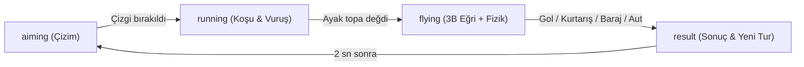

# ⚽ Score Kick 3D

**Three.js** ve **TypeScript** ile harici 3B model, hazır sprite veya ses/doku dosyası kullanılmadan **%100 kodla** oluşturulmuş, *Score! Hero* tarzı çizerek falsolu şut çekme prototipi.


---

## ✨ Özellikler

* **Çizerek Falso Verme (*Draw-to-Shoot*):** Ekranda topun üzerinden kaleye doğru çizdiğin 2B eğri, gerçek zamanlı olarak 3B `CatmullRomCurve3` yörüngesine çevrilir; sağa/sola verdiğin kavis doğrudan topun falsosuna dönüşür.
* **Canlı 3B Yörünge Önizlemesi:** Çizim sırasında topun izleyeceği noktalı eğri ve kale düzlemindeki hedef halkası anlık gösterilir (isabetli şutlarda yeşil, dışarıda sarı).
* **Prosedürel Futbolcu Animasyonu:** Koşarak yaklaşma, destek ayağını basma, bacağı geriye çekip vurma ve vuruş sonrası denge takibi tamamen eklemli kod hiyerarşisiyle üretilir.
* **Atlayan Kaleci ve Fizik:** Kaleci topun açısına göre kale önünde yer tutar; şut çekildiğinde reaksiyon süresi sonrası topun hedefine doğru yatıp uzanır ve gövde/eldiven çarpışmasıyla topu kurtarabilir.
* **Rastgele Baraj:** Her pozisyonda rastgele olarak baraj kurulur (bazen **2–4 kişilik zıplayan baraj**, bazen **barajsız** açık vuruş).
* **Deforme Olan Kale Ağı ve Direk Fiziği:** Top direklere veya üst direğe çarpınca gerçekçi şekilde seker; gol olduğunda çarptığı noktada kale ağını dalgalandırır.
* **Tamamen Canvas İçi HUD:** Skor tabelası (`GOL / ŞUT`), yönlendirme metni ve sonuç bildirimleri (`GOL!`, `KURTARDI!`, `BARAJ!`, `DİREK!`, `AUT!`) ortografik katman üzerinden doğrudan WebGL canvas'ının içine çizilir.
* **Her Şutta Yeni Pozisyon:** Her vuruşun ardından (veya `R` tuşuna basıldığında) oyuncu ve top farklı açı ve mesafelere taşınır.

---

## 🎮 Nasıl Oynanır?

1. **Nişan Al ve Çiz:** Mouse (veya dokunmatik ekran) ile topun üzerinden kaleye doğru istediğin kavisle bir çizgi çek.
2. **Bırak ve Vur:** Parmağını/tuşu bıraktığında 10 numaralı futbolcu koşup çizdiğin eğriye uygun falsolu şutu çeker.
3. **Yeni Pozisyon:** Pozisyonu manuel değiştirmek için alttaki **Yeni Pozisyon (R)** butonunu kullan veya `R` tuşuna bas.

---

## 🏗️ Teknik Mimari

```
src/
├── main.ts         # Oyun döngüsü, giriş olayları, kamera takibi ve çarpışma akışı
├── pitch.ts        # Prosedürel çim dokusu, saha çizgileri, kale ve dalgalanan ağ
├── ball.ts         # Beşgen desenli prosedürel futbol topu, dönüş (spin) ve temas gölgesi
├── humanoid.ts     # Ortak eklemli karakter iskeleti (futbolcu, kaleci, baraj)
├── player.ts       # 10 numaralı şutör ve koşu/vuruş animasyonları
├── goalkeeper.ts   # Kaleci yerleşimi, dalış animasyonu ve kurtarış çarpışması
├── wall.ts         # Rastgele 2-4 kişilik baraj yerleşimi, zıplama ve blok çarpışması
├── trajectory.ts   # 2B çizim → 3B eğri dönüşümü, önizleme ve direk çarpışma fiziği
├── hud.ts          # Canvas içi 2D HUD oluşturucu ve ortografik overlay render katmanı
└── style.css       # Tam ekran taşmasız görünüm düzeni
```

### Oyun Durum Akışı



---

## 🚀 Kurulum ve Çalıştırma

```bash
# Bağımlılıkları yükle
pnpm install

# Geliştirme sunucusunu başlat
pnpm dev

# TypeScript kontrolü ve production build al
pnpm run build
```

> `pnpm` veya `npm` ile çalıştırılabilir (`npm install`, `npm run dev`, `npm run build`).
