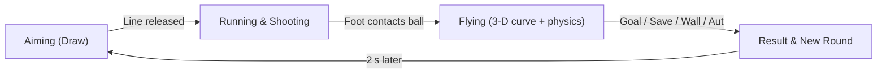

# ⚽ Score Kick 3D

**Score Kick** is a 3D browser demo built with **Three.js** and **TypeScript**. The entire experience – from the football player animation to the ball physics, goalkeeper, and optional defensive wall – is created **100 % with code**, without external 3D models, sprites, or assets.

---

## ✨ Features

- **Draw‑to‑Shoot**: Drag a curve on the screen; the 2‑D line is converted into a 3‑D `CatmullRomCurve3` trajectory in real time. The curve determines the ball's spin and direction.
- **Live Trajectory Preview**: While drawing, a dotted path shows the future ball flight, turning green on a goal‑worthy shot and yellow otherwise.
- **Procedural Player Animation**: The striker runs, plants a foot, swings the leg and follows through, all generated by code‑driven skeleton rigging.
- **Goalkeeper & Physics**: The keeper reacts to the incoming shot, dives, and can block the ball. Collision handling also includes realistic post‑goal net deformation.
- **Random Defensive Wall**: On approximately two‑thirds of attempts a random wall of 2‑4 players appears; sometimes there is no wall at all.
- **Deformable Goal Net & Posts**: The net ripples when the ball hits, and the posts bounce the ball realistically.
- **Full‑Screen HUD Inside Canvas**: Score, shot count, and result messages (`GOAL!`, `SAVED!`, `WALL!`, `POST!`, `AUT!`) are rendered with an orthographic overlay directly on the WebGL canvas.
- **New Position Each Shot**: After every shot (or when pressing **R**) the player and ball are repositioned to a fresh angle and distance.

---

## 🎮 How to Play

1. **Aim & Draw** – Click (or tap) on the ball and drag toward the goal to define a curve.
2. **Release & Shoot** – When you release the mouse button, the striker runs and takes a curved shot following the drawn trajectory.
3. **Reset Position** – Click the **New Position (R)** button or press the **R** key to move the player to a new spot.

---

## 🏗️ Technical Architecture

```
src/
├── main.ts         # Game loop, input handling, camera, and collision flow
├── pitch.ts        # Procedural grass, field lines, goal posts, and net deformation
├── ball.ts         # Procedural soccer ball with spin and shadow
├── humanoid.ts     # Shared joint skeleton for player, goalkeeper, and wall
├── player.ts       # Striker (number 10) animation and shooting logic
├── goalkeeper.ts   # Goalkeeper placement, dive animation, and save detection
├── wall.ts         # Random 2‑4‑person defensive wall generation
├── trajectory.ts   # 2‑D drawing → 3‑D curve conversion, preview, and post‑collision physics
├── hud.ts          # In‑canvas 2‑D HUD and overlay rendering
└── style.css       # Full‑screen layout without overflow
```

### Game Flow Diagram



---

## 🚀 Setup & Run

```bash
# Install dependencies
pnpm install

# Start development server (hot‑reloading)
pnpm dev

# Build for production
pnpm run build
```

> The project works with either `pnpm` or `npm` (`npm install`, `npm run dev`, `npm run build`).

---

## 📦 Repository

The source code is hosted on GitHub:

https://github.com/sunman54/Goller

Feel free to fork, star, or contribute!
